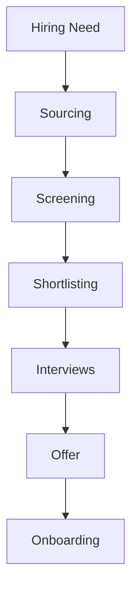
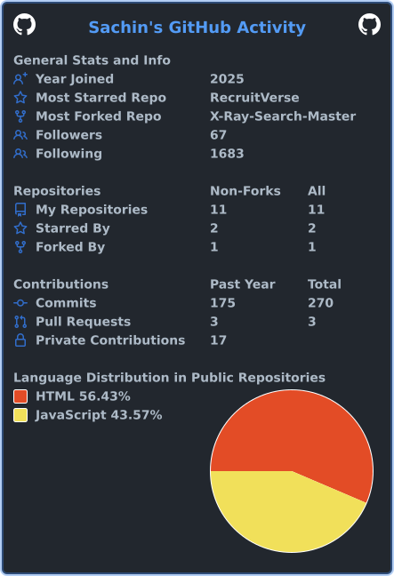
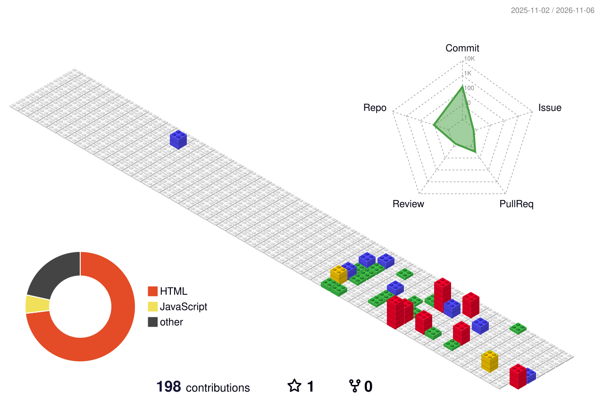
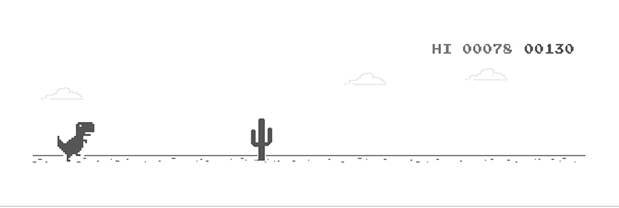

<p align="center">  </p>


<div align="center">


[](https://git.io/typing-svg)

</div>

<h3 align="center">
  

<a href="https://github.com/ITRecruitersachin?tab=followers">
&nbsp;&nbsp;

<a href="https://github.com/ITRecruitersachin?tab=repositories">


</a>
</h3>


##  &nbsp;About ME

<table>
<tr>
<td width="55%">

```yaml
# ══════════════════════════════════════
#   SACHIN R  |  RECRUITER PROFILE CARD
# ══════════════════════════════════════

Identity:
  Name        : "Sachin R Jain"

Contact:
  Email          : "sachin.r@fornaxtech.com"
  Linkedin       : "linkedin.com/in/Recruitersachin"
  Kaggle         : "https://huggingface.co/recruitersachin"
  StackOverflow  : "https://stackoverflow.com/users/31557148/sachin"
  Phone          : "(718) 210-9567"
  Email          : sachin.r@fornaxtech.com

```

</td>
<td width="45%" align="center">

<br/><br/>


</td>
</tr>
</table>


## 🎓 LinkedIn Learning Certifications

| Certification | Provider | Credential |
|---------------|----------|------------|
| 🏅 **Niche Recruiting** | LinkedIn Learning | [View Certificate](https://www.linkedin.com/learning/certificates/de0aabefe2cc74c02d337c5a8b67ee378811c21086649bac4384b51cd96b73e5/) |
| 🏅 **Technical Recruiting** | LinkedIn Learning | [View Certificate](https://www.linkedin.com/learning/certificates/4774b60946f70c67f95d1c8cb43d51378af79c7a16e92a46ce8503094829a504/) |
| 🏅 **Generative AI, Recruiting & Talent Acquisition** | LinkedIn Learning | [View Certificate](https://www.linkedin.com/learning/certificates/a7882075e24f4c29bc05baadc3559acbc00f3bf849b36ad31fad4c7e68f3d9f3/) |
| 🏅 **Hire Better, Hire Faster with Social Media** | LinkedIn Learning | [View Certificate](https://www.linkedin.com/learning/certificates/76854da4e0b6cc8a137a14484fb8a349604e4aeb710dda9bf8cdd80a2262259e/) |
| 🏅 **AI Agents for Everyday Professionals** | LinkedIn Learning | [View Certificate](https://www.linkedin.com/learning/certificates/fcc0e5f8bee3c176fb288da92c3ddd60dbe1e946daebe200a4531ba04a8837b0/) |

<br/>


## 🗺️ Nationwide Coverage


> Region groupings follow the standard U.S. Census Bureau definitions (Northeast: 9 · Midwest: 12 · South incl. D.C.: 17 · West: 13 = 51).


## 🧾 Engagement Types Handled

<div align="center">

</div>

| Type | What it means | What I handle |
|---|---|---|
| W2 | Candidate is employed by the staffing agency / employer of record | Payroll coordination, benefits eligibility docs, I-9/E-Verify, tax withholding forms |
| C2C | Candidate's own corporation contracts with the vendor/client | MSA/SOW review, vendor onboarding, invoicing cadence, corp-to-corp compliance docs |
| 1099 | Candidate works as an independent contractor | Contractor agreements, scope-of-work documentation, W-9 collection |


## ⚖️ Legal, Compliance & Onboarding
✅ Form I-9 verification & E-Verify processing
✅ W-4 / W-9 tax documentation collection
✅ Background checks & drug-screening coordination
✅ Right-to-work documentation & visa/status verification (H-1B, GC, USC, OPT/CPT, TN, L-1, E-3)
✅ MSA / SOW review coordination with vendor management
✅ NDA & non-compete documentation handling
✅ VMS experience: Fieldglass, Beeline, IQNavigator/SAP Fieldglass
✅ Timesheet approval workflows & C2C invoicing coordination
✅ State-specific labor law awareness across all 50 states
✅ Offer letter generation, background/reference verification, new-hire paperwork


**Free & Niche Sourcing Sources:**
   -181717?style=flat-square&logo=github&logoColor=white)  


## 🤖 AI-Assisted Sourcing Platforms
HireEZ · Hiretual · Fetcher.ai · Findem.ai · Juicebox.io · SeekOut · Entelo · Eightfold.ai · AI X-Ray Sourcing


## 📈 Candidate Database Growth

<div align="center">

</div>

(Sample growth curve — plug in actual year-by-year database size if tracked.)


## 🛠️ Skills & Competency Matrix

```text
╔════════════════════════════════════════════════════════════════════════════════════════════════════╗
║                               U S   I T   R E C R U I T M E N T                                     ║
╠════════════════════════════════════════════════════════════════════════════════════════════════════╣
║ CORE RECRUITING EXPERTISE                                PROFICIENCY        EXPERIENCE               ║
╠════════════════════════════════════════════════════════════════════════════════════════════════════╣
║ Full-Cycle US IT Recruitment                             ████████████████████   10+ Years           ║
║ Boolean Search & Google X-Ray Sourcing                   ████████████████████   10+ Years           ║
║ W2 • C2C • 1099 • Corp-to-Corp Hiring                    ████████████████████   10+ Years           ║
║ LinkedIn Recruiter & Passive Talent Sourcing             ███████████████████░    9+ Years           ║
║ Technical Screening & Candidate Assessment               ███████████████████░    9+ Years           ║
║ Candidate Experience & Relationship Management           ███████████████████░   10+ Years           ║
║ Offer Negotiation & Closing                              ██████████████████░░   10+ Years           ║
║ Salary & Rate Negotiation                                ██████████████████░░   10+ Years           ║
║ Resume Optimization & Marketing                          ██████████████████░░   10+ Years           ║
║ Talent Pipeline Development                              ███████████████████░   10+ Years           ║
╠════════════════════════════════════════════════════════════════════════════════════════════════════╣
║ ATS • CRM • VMS PLATFORMS                                                                            ║
╠════════════════════════════════════════════════════════════════════════════════════════════════════╣
║ Bullhorn ATS                                             ███████████████████░                       ║
║ JobDiva                                                  ███████████████████░                       ║
║ Ceipal                                                   ██████████████████░░                       ║
║ VectorVMS                                                ██████                       ║║
╠════════════════════════════════════════════════════════════════════════════════════════════════════╣
║ SOURCING CHANNELS                                                                                    ║
╠════════════════════════════════════════════════════════════════════════════════════════════════════╣
║ LinkedIn Recruiter                                      ████████████████████                        ║
║ GitHub                                                   ███████████████████░                       ║
║ Dice                                                     ████████████████████                        ║
║ Monster                                                  ███████████████████░                       ║
║ CareerBuilder                                            ██████████████████░░                       ║
║ Indeed Resume                                            ██████████████████░░                       ║
║ Google X-Ray                                             ████████████████████                        ║
║ Boolean Search                                           ████████████████████                        ║
║ Internal Candidate Database                              ████████████████████                        ║
╠════════════════════════════════════════════════════════════════════════════════════════════════════╣
║ RECRUITMENT SPECIALIZATIONS                                                                          ║
╠════════════════════════════════════════════════════════════════════════════════════════════════════╣
║ Federal & State Government Staffing                      ███████████████████░                       ║
║ Commercial Technology Recruiting                         ████████████████████                        ║
║ AI / Machine Learning                                    ██████████████████░░                       ║
║ Cloud Infrastructure                                     ██████████████████░░                       ║
║ Cybersecurity                                            ██████████████████░░                       ║
║ Data Engineering                                         ██████████████████░░                       ║
║ Software Engineering                                     ███████████████████░                       ║
║ ERP / CRM Technologies                                   █████████████████░░░                       ║
╠════════════════════════════════════════════════════════════════════════════════════════════════════╣
║ LEADERSHIP & STRATEGY                                                                                 ║
╠════════════════════════════════════════════════════════════════════════════════════════════════════╣
║ Team Leadership (12+ Recruiters)                         ██████████████████░░    5 Years            ║
║ Executive / VP / C-Suite Search                          █████████████████░░░    4 Years            ║
║ Workforce Planning & Talent Strategy                     █████████████████░░░    4 Years            ║
║ Employer Branding & EVP                                  ████████████████░░░░    4 Years            ║
╠════════════════════════════════════════════════════════════════════════════════════════════════════╣
║ EMERGING & TECH TOOLS                                                                                 ║
╠════════════════════════════════════════════════════════════════════════════════════════════════════╣
║ AI-Powered Sourcing (HireEZ, Fetcher)                    █████████████████░░░    3 Years            ║
║ Data Analytics & Recruiting Metrics                      ████████████████░░░░    4 Years            ║
║ Diversity, Equity & Inclusion Hiring                     ████████████████░░░░    3 Years            ║
╠════════════════════════════════════════════════════════════════════════════════════════════════════╣
║ PROFESSIONAL STRENGTHS                                                                                 ║
╠════════════════════════════════════════════════════════════════════════════════════════════════════╣
║ ✔ Full-Cycle Recruitment                                                         Expert              ║
║ ✔ Passive Talent Engagement                                                      Expert              ║
║ ✔ Pipeline Building & Talent Communities                                         Expert              ║
║ ✔ Stakeholder & Hiring Manager Partnership                                       Advanced            ║
║ ✔ Interview Coordination & Offer Management                                      Advanced            ║
║ ✔ Compliance & Work Authorization Validation                                     Advanced            ║
║ ✔ Recruitment Analytics & KPI Tracking                                           Advanced            ║
║ ✔ AI-Assisted Recruiting Workflows                                               Advanced            ║
╚════════════════════════════════════════════════════════════════════════════════════════════════════╝
```

<div align="center">

### 🎯 Core Focus Areas

`US IT Recruitment` • `Federal & State Staffing` • `Commercial Hiring` • `Boolean Search`
`Google X-Ray` • `LinkedIn Recruiter` • `Passive Talent`
`ATS Administration` • `Pipeline Development`
`W2` • `C2C` • `1099`
`AI-Assisted Recruiting`

</div>

---

## 🏰 The Kingdom Map



## Roadmap

- [x] Add core features.
- [x] Improve documentation.
- [x] Enterprise GitHub Portfolio
- [x] Advanced Recruiter Branding
- [x] ATS & VMS Knowledge Base
- [x] Boolean & X-Ray Search Library
- [x] AI Recruiting Workflow Documentation
- [ ] AI Resume Analyzer
- [ ] Candidate Matching Engine
- [ ] Recruiter Analytics Dashboard
- [ ] Automated Outreach Templates
- [ ] Interview Intelligence Toolkit
- [ ] Talent Market Insights
- [ ] Recruiting KPI Dashboard
- [ ] Personal Recruiter Website
- [ ] Open Source Recruiting Toolkit
- [ ] Add authentication.
- [ ] Add production deployment.

```text
███████████████████████████████████████░░░░░░░░░░░░░░░░░░░░░░░░░  65% complete
```

<div align="center">

### ⚡ Recruit • Engage • Evaluate • Deliver

*Building scalable recruiting pipelines through technology, automation, market intelligence, and human relationships.*

</div>

---

## 📈 Placement Analytics Dashboard

```
━━━━━━━━━━━━━━━━━━━━━━━━━━━━━━━━━━━━━━━━━━━━━━━━━━━━━━━━━━━━━━━━━━━━━━━━━━━━━━━━━
  📊 PLACEMENTS BY WORK TYPE          📊 PLACEMENTS BY TECH DOMAIN
━━━━━━━━━━━━━━━━━━━━━━━━━━━━━━━━━━━━━━━━━━━━━━━━━━━━━━━━━━━━━━━━━━━━━━━━━━━━━━━━━

  W2 Contract       ▓▓▓▓▓▓▓▓░  48%      Cloud / AWS / Azure   ▓▓▓▓▓▓▓▓░  38%
  C2C Contract      ▓▓▓▓▓▓░░░  16%      Data / ML / AI        ▓▓▓▓▓▓░░░  26%
  Contract-to-Hire  ▓▓▓▓▓░░░░  22%      Full Stack Dev        ▓▓▓▓▓░░░░  20%
  Full-Time (FTE)   ▓▓▓▓░░░░░  14%      SAP / Oracle / ERP    ▓▓▓░░░░░░  10%
                                          Cyber / Network        ▓▓░░░░░░░   6%

━━━━━━━━━━━━━━━━━━━━━━━━━━━━━━━━━━━━━━━━━━━━━━━━━━━━━━━━━━━━━━━━━━━━━━━━━━━━━━━━━
  📊 US GEOGRAPHY BREAKDOWN            📊 CLIENT SIZE MIX
━━━━━━━━━━━━━━━━━━━━━━━━━━━━━━━━━━━━━━━━━━━━━━━━━━━━━━━━━━━━━━━━━━━━━━━━━━━━━━━━━

  California        ▓▓▓▓▓▓▓▓░  30%      Fortune 500           ▓▓▓▓▓▓▓▓░  45%
  New York / NJ     ▓▓▓▓▓▓░░░  23%      Mid-Market ($50M+)    ▓▓▓▓▓▓░░░  28%
  Texas             ▓▓▓▓░░░░░  16%      High-Growth Startup   ▓▓▓▓░░░░░  18%
  Illinois/Midwest  ▓▓▓░░░░░░  12%      Government / DoD      ▓▓░░░░░░░   9%
  Other US States   ▓▓▓▓▓░░░░  19%

━━━━━━━━━━━━━━━━━━━━━━━━━━━━━━━━━━━━━━━━━━━━━━━━━━━━━━━━━━━━━━━━━━━━━━━━━━━━━━━━━
  📊 KEY PERFORMANCE INDICATORS
━━━━━━━━━━━━━━━━━━━━━━━━━━━━━━━━━━━━━━━━━━━━━━━━━━━━━━━━━━━━━━━━━━━━━━━━━━━━━━━━━
  Offer Acceptance Rate    ▓▓▓▓▓▓▓▓▓▓▓▓▓▓▓▓▓▓▓░  95%  (Industry avg: 62%)
  90-Day Retention         ▓▓▓▓▓▓▓▓▓▓▓▓▓▓▓▓▓▓░░  91%  (Industry avg: 74%)
  Client Repeat Rate       ▓▓▓▓▓▓▓▓▓▓▓▓▓▓▓▓▓░░░  88%
  Candidate Satisfaction   ▓▓▓▓▓▓▓▓▓▓▓▓▓▓▓▓▓▓▓░  97%  (4.9/5.0 survey avg)
━━━━━━━━━━━━━━━━━━━━━━━━━━━━━━━━━━━━━━━━━━━━━━━━━━━━━━━━━━━━━━━━━━━━━━━━━━━━━━━━━
```


# 🛰️ TALENT ACQUISITION COMMAND CENTER

```text
╔════════════════════════════════════════════════════════════════════════════════════════════════════════════════════════════╗
║                                    US RECRUITING OPERATIONS CENTER v10.0                                                    ║
╠════════════════════════════════════════════════════════════════════════════════════════════════════════════════════════════╣
║  █ SYSTEM STATUS                                                                                                            ║
║   ● Talent Intelligence Engine               ONLINE            ███████████████████████████████████████████████             ║
║   ● Candidate Discovery Network              ACTIVE            ███████████████████████████████████████████████             ║
║   ● AI Resume Intelligence                   RUNNING           ███████████████████████████████████████████████             ║
║   ● Boolean Search Engine                    READY             ███████████████████████████████████████████████             ║
║   ● X-Ray Search Grid                        READY             ███████████████████████████████████████████████             ║
║   ● ATS Synchronization                      CONNECTED         ███████████████████████████████████████████████             ║
║   ● Vendor Management                        OPERATIONAL       ███████████████████████████████████████████████             ║
║   ● Federal Recruiting                       SECURE            ███████████████████████████████████████████████             ║
╠════════════════════════════════════════════════════════════════════════════════════════════════════════════════════════════╣
║                                      █ RECRUIT. ENGAGE. DELIVER. REPEAT. █                                                   ║
╚════════════════════════════════════════════════════════════════════════════════════════════════════════════════════════════╝
```

---

## 💬 References & Testimonials

> **Edgar Dace**
> 🔗 https://www.linkedin.com/in/edgardace/
>
> *"Sachin is a very personable professional who consistently prioritizes both employees and clients. He goes above and beyond to ensure client satisfaction and is always eager to deliver exceptional service. His commitment, professionalism, and dedication make him a valuable asset to any organization."*


> **Anastasia Bielka**
> 🔗 https://www.linkedin.com/in/anastasiia-bielka/
>
> *"Most recruiters are only a brief part of the job search process, but Sachin left a lasting impression. During my transition into my first full-time role in the gaming industry at Q Analysts, he was attentive, detail-oriented, and always quick to respond. He patiently answered my questions, respected my preferred communication style, and made the onboarding process smooth and stress-free.*
>
> *Sachin helped me feel confident while completing documentation and joining a new team. His professionalism, flexibility, and genuine support made a significant difference, and I believe any organization would benefit from having him as a recruiter."*


<!-- ========================================= -->
<!-- 📊 GitHub Analytics -->
<!-- ========================================= -->

<h2 align="center">📊 GitHub Analytics</h2>


<p align="center">
  
  

</p>

## 📊 GitHub Stats

<p align="center">
  
  
  
</p>

<p align="center">
  
</p>

<p align="center">
  
</p>

<div align="center">
  
</div>


<h2 align="center">📈 Contribution Activity</h2>

<p align="center">
  
</p>

<div align="center">
  
  
</div>


<h2 align="center">🔥 Contribution Heatmap</h2>

<p align="center">
  
</p>


<p align="center">
  Pacman Contribution Graph Action
  <picture>
  <source
    media="(prefers-color-scheme: dark)"
    srcset="https://raw.githubusercontent.com/ITRecruitersachin/ITRecruitersachin/pacman-output/pacman-contribution-graph-dark.svg"
  />
  <source
    media="(prefers-color-scheme: light)"
    srcset="https://raw.githubusercontent.com/ITRecruitersachin/ITRecruitersachin/pacman-output/pacman-contribution-graph.svg"
  />
  
</picture>


<h2 align="center">🐍 Contribution Snake</h2>

<p align="center">
<picture>
  <source media="(prefers-color-scheme: dark)" srcset="https://raw.githubusercontent.com/ITRecruitersachin/Z/output/github-contribution-grid-snake-dark.svg">
  <source media="(prefers-color-scheme: light)" srcset="https://raw.githubusercontent.com/ITRecruitersachin/Z/output/github-contribution-grid-snake.svg">
  
</picture>
</p>


<div align="center">


</div>


## ⭐ Star History

<p align="center">
  
  <a href="https://star-history.com/#ITRecruitersachin/ITRecruitersachin&Date">
    <picture>
      <source
        media="(prefers-color-scheme: dark)"
        srcset="https://api.star-history.com/svg?repos=ITRecruitersachin/ITRecruitersachin&type=Date&theme=dark"
      />
      <source
        media="(prefers-color-scheme: light)"
        srcset="https://api.star-history.com/svg?repos=ITRecruitersachin/ITRecruitersachin&type=Date"
      />
      
    </picture>
  </a>
</p>


## 🌟 The Royal Decree

> "Great recruitment is not just filling roles — it is building strong teams, one excellent hire at a time."

---

# 👁️ Visitors Who Discovered the Aurora

<div align="center">

[](https://hits.sh/github.com/ITRecruitersachin/ITRecruitersachin/)

### 🌌 Recruiters • Hiring Managers • Candidates • Talent Partners

*"Every visit is a new opportunity to connect exceptional talent with exceptional organizations."*

</div>


# 🌠 Let's Connect

<div align="center">

> ### *"Exceptional talent isn't always visible. The right recruiter knows where to look."*

### 🚀 Recruiting Expertise

🏛️ **Federal • State • Commercial Recruiting**
☁️ **AI/ML • Cloud • Cybersecurity • Data • ERP • Software Engineering**
💼 **Full-Time • Contract • Contract-to-Hire • W2 • C2C • 1099**
🌐 **15K+ LinkedIn Network • Curated Candidate Database • AI-Powered Talent Sourcing**

<br>

<a href="mailto:writeforsachin@gmail.com">

</a>
<a href="https://www.linkedin.com/in/recruitersachin">

</a>
<a href="mailto:writeforsachin@gmail.com?subject=Candidate%20Submission">

</a>
<a href="https://calendly.com/ITRecruitersachin">

</a>

<br><br>


### ✨ Aurora Talent Network

*Connecting organizations with exceptional technology professionals through strategic sourcing, trusted relationships, and modern recruiting.*

</div>


```text
╔══════════════════════════════════════════════════════════════════════════════╗
║                     READY TO CONNECT?                                        ║
╠══════════════════════════════════════════════════════════════════════════════╣
║ 💼 Hiring Manager           → Let's discuss your hiring roadmap             ║
║ 👨‍💻 Technology Professional  → Explore current opportunities                  ║
║ 🤝 Recruitment Partner      → Vendor & recruiting collaboration              ║
║ 🏛 Government Programs       → Federal & State staffing support               ║
║ 🚀 Startup Founder          → Scale your engineering organization            ║
╚═══════════════════════════════════════════════════════════════════════════════╝
```


<div align="center">

### ⭐ Recruit • Connect • Deliver • Repeat ⭐

</div>


### ⭐ If you found my profile helpful, consider giving it a ⭐

<div align="center">
  **© 2026 Sachin R • Senior US IT Recruiter • Bengaluru, India**
  *Federal • State • Commercial • AI • Cloud • Cybersecurity • Data Engineering*
  **📍 Bengaluru, India 🇮🇳 &nbsp;·&nbsp; 🌐 Remote — All US States &nbsp;·&nbsp; ⏰ IST (GMT+5:30) &nbsp;·&nbsp; 🟢 Available Immediately**
  *Made with ❤️ by Sachin — Lead Senior US IT Recruiter*

</div>


# 🤝 Connect With Me

<div align="center">

[](https://linkedin.com/in/recruitersachin)

[](mailto:writeforsachin@gmail.com)

[](https://wa.me/919742080111)

[](https://calendly.com/ITRecruitersachin)

</div>


<div align="center">
<a href="https://git.io/typing-svg">

</a>

<a href="https://git.io/typing-svg">

</a>
</div>

<div align="center">


<br/>


</div>

<div align="center">

[](https://linkedin.com/in/recruitersachin)
[](mailto:writeforsachin@gmail.com)
[](https://wa.me/919742080111)
[](https://calendly.com/ITRecruitersachin)
[](https://github.com/ITRecruitersachin)

</div>

<br/>


<div align="center">
   
</div>


<p align="center">

</p>


